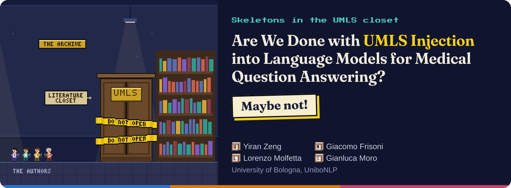
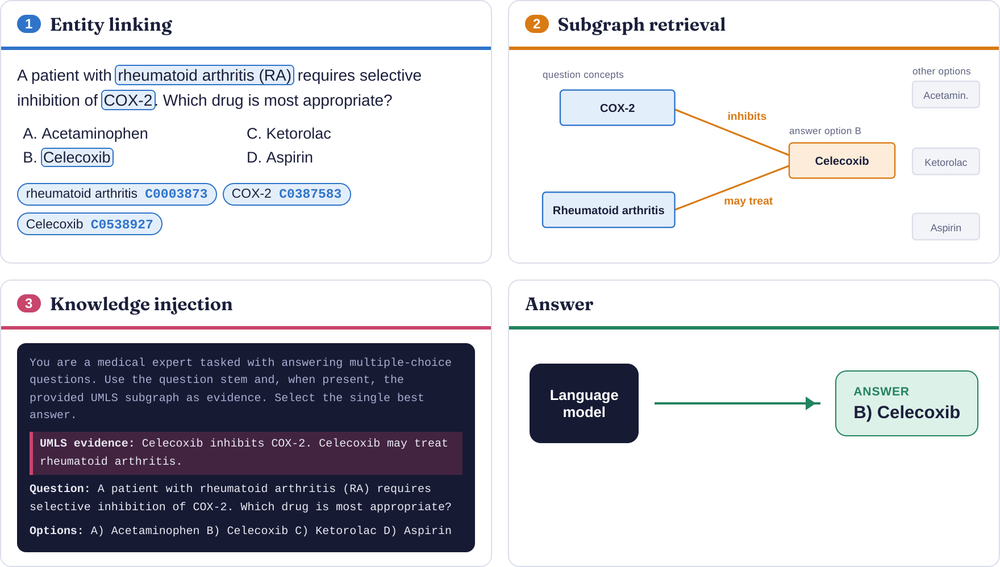
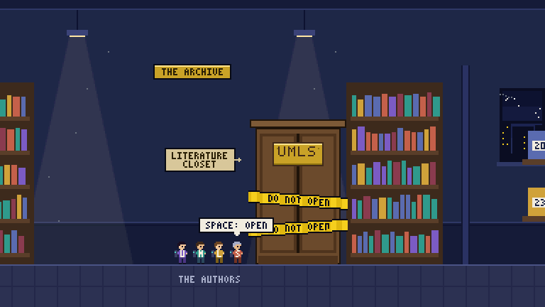

<a id="top"></a>
<p align="center">
  
</p>

<p align="center">
  <a href="https://arxiv.org/abs/2610.33801"></a>
  <a href="https://disi-unibo-nlp.github.io/are-we-done-with-umls/"></a>
  <a href="https://disi-unibo-nlp.github.io/are-we-done-with-umls/play.html"></a>
  <a href="#reproduce"></a>
</p>

<p align="center"><sub>All authors contributed equally &middot; Department of Computer Science and Engineering, University of Bologna, Italy &middot; <a href="https://disi-unibo-nlp.github.io/">UniboNLP</a></sub></p>

Language models that answer medical exam questions are often given **UMLS**, the Unified Medical Language System of the US National Library of Medicine: a large database of medical terminology, built by joining the main medical vocabularies. Dozens of papers report that it helps, yet the gains are small, and nobody had checked whether they come from UMLS at all.

We review every study from 2020 to 2025 that injects UMLS into language models for medical question answering, **25 in total**, and rebuild their construction choices one at a time with controlled experiments. UMLS is rarely used as a stable resource: releases, vocabulary filters, entity linkers, retrieval rules and silent fallbacks reshape it before any model reads it, so reported gains describe whole pipelines.

> **Are we done with UMLS injection? Maybe not.** UMLS has not yet been tested in a way that isolates its contribution. This repository holds the per-paper annotations, the code of our experiments, and the project page with its 8-bit game.

## Contents

- [How a model uses UMLS](#pipeline)
- [Play the findings](#game)
- [Nine skeletons in the closet](#findings)
- [What to report with every UMLS result](#checklist)
- [Review methodology](#method)
- [The 25 reviewed studies](#papers)
- [Repository structure](#structure)
- [Reproduce the experiments](#reproduce)
- [Website and game](#website)
- [Citation](#citation)

<a id="pipeline"></a>
## How a model uses UMLS

Every reviewed system turns an exam question into model input in three steps. Here they are on one question: the linker maps medical terms to UMLS concept IDs, retrieval collects the relations that connect question and options, and injection hands those facts to the model, here written into its prompt.

<p align="center"></p>

| Step | What it does | Where variation enters |
|---|---|---|
|  | Grounds the text of the question and of each option to UMLS concepts | Linker choice; coverage of question stems against answer options |
|  | Selects a question-specific neighborhood of the UMLS graph | Expansion depth ($K$), pruning budget, connectivity rule, fallback when nothing links |
|  | Decides how the selected knowledge reaches the model | Textual linearization, structural injection, or parameter encoding |

Each step loses evidence unevenly across the input, and the combined effect is rarely reported. You can step through this example interactively on the [project page](https://disi-unibo-nlp.github.io/are-we-done-with-umls/#how).

<a id="game"></a>
## Play the findings

The whole study is also an 8-bit game. The four authors learn how UMLS works in their lab, open the literature closet, and catch the nine skeletons that escape, each one a finding of the paper explained with questions, mini-games and charts. About ten minutes, in the browser, on desktop or on a phone held sideways.

<p align="center"><a href="https://disi-unibo-nlp.github.io/are-we-done-with-umls/play.html"></a><br><sub><a href="https://disi-unibo-nlp.github.io/are-we-done-with-umls/play.html">Play Skeletons in the UMLS closet</a></sub></p>

<a id="findings"></a>
## Nine skeletons in the closet

Each finding is a construction choice that changes the UMLS evidence a model receives. The project page explains each one with its chart and the figure from the paper.

| # | Stage | Finding | In numbers |
|---|---|---|---|
| 1 |  | **Most papers never say which UMLS they used** <br><sub>Skeleton 1: The Phantom Release</sub> | **84%** of the papers never say which release they used |
| 2 |  | **UMLS shrinks to names and relations** <br><sub>Skeleton 2: The Two-Table Skeleton</sub> | **2 of 23** tables used by almost every paper |
| 3 |  | **The linker decides what UMLS can offer** <br><sub>Skeleton 3: The Linker Lottery</sub> | **116 vs 58** concepts per MedQA question, MetaMap against scispaCy |
| 4 |  | **Same linker, different UMLS, different evidence** <br><sub>Skeleton 4: The Shapeshifter</sub> | **99.4%** of the MedQA questions get different concepts |
| 5 |  | **The answers never enter UMLS** <br><sub>Skeleton 5: The Missing Answer</sub> | **58.8%** of the answer options link no concept |
| 6 |  | **The evidence explodes, then gets cut** <br><sub>Skeleton 6: The Hydra Subgraph</sub> | **1.3M** concepts collected after five hops |
| 7 |  | **Silent placeholders replace missing evidence** <br><sub>Skeleton 7: The Stand-in Twins</sub> | **Serine** stands in for any question that links nothing |
| 8 |  | **The gains hide in the noise** <br><sub>Skeleton 8: The Empty Graph</sub> | **37.4%** QA-GNN accuracy with an empty graph |
| 9 |  | **How UMLS is written into the prompt changes the result** <br><sub>Skeleton 9: The Reader’s Riddle</sub> | **9 of 10** models prefer plain relations on PubMedQA |

<a id="checklist"></a>
## What to report with every UMLS result

Reporting all nine choices is the minimum for a gain to be traceable to UMLS.

| # | Stage | Report | What it means |
|---|---|---|---|
| 1 |  | **UMLS release** | Which release was used, for example 2023AA. |
| 2 |  | **Sources and filters** | Which vocabularies were kept and which concepts or relations were filtered out. |
| 3 |  | **Concept metadata** | Which fields reach the model, such as definitions and semantic types. |
| 4 |  | **Entity linker** | Which tool and which non-default settings. |
| 5 |  | **Linking coverage** | How many questions and answer options link nothing. |
| 6 |  | **Connectivity rule** | Which concepts are connected when collecting evidence. |
| 7 |  | **Depth and size** | How many hops, and how large the collected subgraph is. |
| 8 |  | **Pruning** | The rule and the node budget used to trim the subgraph. |
| 9 |  | **Fallback** | What the system does when linking finds nothing. |

<a id="method"></a>
## Review methodology

**Search.** A PRISMA-style systematic review on Scopus (query in [`SCOPUS_Query`](SCOPUS_Query)), run on January 15, 2026, covering English-language conference and journal papers published from 2020 to 2025 on knowledge graphs and structured representations for NLP-based question answering and reasoning. From 1,183 records, 45 were screened in full and **25 were included**: 15 on multiple-choice exams and 10 on free-text answers or related reasoning tasks.

**Inclusion criteria.** A paper was retained if all three hold:

1. **UMLS plays a substantive methodological role**, beyond being cited as background or used only for vocabulary normalization.
2. **The task is medical QA or a closely related reasoning setting**, including biomedical textual entailment, knowledge-augmented clinical NER (when used to test UMLS-injected knowledge), and retrieval-augmented medical QA.
3. **The pipeline is described in enough detail for stage-level comparison**, or, where the paper is structurally important to a specific argument of the review, enough public information allows us to characterize its UMLS use.

**Adjacent settings, cited but not reviewed in depth.** UMLS-based benchmark generation (e.g., Adjei-Frempah et al., 2024), hierarchy-oriented knowledge fusion (e.g., Lu et al., 2023), and dataset construction via CUI normalization (e.g., Wu et al., 2021) inform the motivation of the review; the paper cites them where their evidence bears on the analysis.

**Annotation.** Two medical NLP researchers among the authors labeled every screened paper independently, reaching **90.2% agreement**; disagreements were resolved through discussion. Annotations draw first on the paper and its supplement, then on released code, then on code from cited systems, and missing fields are labeled as unreported. Of the 25 studies, 11 release their code and 6 can be reproduced from what they release.

<a id="papers"></a>
## The 25 reviewed studies

Each paper is tagged along the three pipeline steps plus the UMLS tables and subset it draws from. The tag colors follow the stages: brown for the UMLS resource, blue for entity linking, orange for subgraph retrieval, red for knowledge injection, and gray when the paper does not report the detail.

<details>
<summary><b>Tagset</b>: what each badge means</summary>

#### UMLS source: which Metathesaurus tables are used

| Tag | Explanation |
|---|---|
|  | Uses `MRCONSO` (concept names / strings) |
|  | Uses `MRREL` (concept relations) |
|  | Uses `MRSTY` (semantic types) |
|  | Uses `MRDEF` (definitions) |
|  | Uses `SRDEF` (Semantic Network, not Metathesaurus) |
|  | Restricts UMLS via vocabulary, semantic type, or relation filter (e.g., DDB, SNOMED CT, MSH/NCI) |

#### Stage 1: entity linking

| Tag | Explanation |
|---|---|
|  | Entity linking via scispaCy |
|  | Entity linking via MetaMap |
|  | Entity linking via cTAKES |
|  | Surface-form / string-matching linker |
|  | Neural-embedding-based linker |
|  | LLM-prompted entity extraction |
|  | Linker not reported |

#### Stage 2: subgraph retrieval ($K$-hop and budget)

| Tag | Explanation |
|---|---|
|  | One-hop neighborhood |
|  | Two-hop expansion |
|  | Three-hop expansion |
|  | Hard pruning budget to 200 nodes |
|  | Capped at top-20 relations |
|  | Pruning budget not reported |
|  | No question-specific subgraph (global / partitioned KG) |

#### Stage 3: knowledge injection

| Tag | Explanation |
|---|---|
|  | KG fed to the model as structured graph (GNN, cross-modal layers) |
|  | KG flattened to text and prepended/appended to the prompt |
|  | KG knowledge stored in adapters / pretraining objectives |
|  | Injection mechanism not reported |

</details>

> [!NOTE]
> Ordered as in the per-system annotation table of the paper. The badges under each entry give the **UMLS tables used**, an optional **UMLS subset filter**, the **entity linker**, the **$K$-hop and budget** of subgraph retrieval, and the **injection mechanism**. The *Key Points* line keeps our qualitative annotation of what the paper actually does.

1. **DRAGON: Deep Bidirectional Language-Knowledge Graph Pretraining**: Yasunaga et al. (NeurIPS 2022) [[paper](https://proceedings.neurips.cc/paper_files/paper/2022/hash/f43c9e7e3a5e9d9ddb1c1c0b7a3f0e2e-Abstract-Conference.html)] [[code](https://github.com/michiyasunaga/dragon)]<br> <br><br> <br><br>**Key Points:** Deeply bidirectional text-KG pretraining; 2-hop expansion + entity linking; masked LM + KG link prediction joint objectives. Strong fit.

2. **MediSage**: Choudhury et al. (WWW 2023)<br>  <br><br> <br><br>**Key Points:** Conversational clinical decision-support over EHR + clinical KG; BioLinkBERT NEL fallback. Not centered on UMLS as core source.

3. **KnowledgeDA**: Ding et al. (Findings of ACL 2023) [[paper](https://aclanthology.org/2023.findings-acl.477/)] [[code](https://github.com/RuiqingDing/KnowledgeDA)]<br>   <br><br> <br><br>**Key Points:** Mention-to-entity similarity matching; 2-hop relation-consistent replacements; data augmentation around UMLS-grounded entities. UMLS 2021AA; 1.15M CUIs, 4.88M triples after filtering to medicine-related semantic types and 502 relation types.

4. **KG-Infused LLM for Virtual Health Assistant**: Katta et al. (ICMLA 2024) [[code](https://github.com/SivaKatta1010/NeoKG-LLM)]<br>   <br><br> <br><br>**Key Points:** Builds large Neo4j KG from UMLS subsets (MSH + NCI), 622K nodes / 4.94M edges; RAG-style pipeline with semantic matching + learning-to-rank; not question-specific subgraph construction.

5. **QAVSA**: Laube & Eliasmith (RepL4NLP 2024)<br> <br><br> <br><br>**Key Points:** Follows QA-GNN-style graph setup (300K nodes / 1M edges); replaces GNN with vector symbolic algebra + MLP reasoning on MedQA-USMLE.

6. **QAT: Relation-Aware Language-Graph Transformer**: Park et al. (AAAI 2023)<br> <br><br> <br><br>**Key Points:** Per-QA subgraph retrieval (9K nodes / 44K edges); meta-path relation encoding. Q→A connectivity.

7. **QA-GNN: Reasoning with Language Models and Knowledge Graphs for Question Answering**: Yasunaga et al. (NAACL 2021) [[paper](https://aclanthology.org/2021.naacl-main.45/)] [[code](https://github.com/michiyasunaga/qagnn)]<br>  <br><br> <br><br>**Key Points:** Self-constructed biomedical KG (DDB portion of UMLS + DrugBank; 9K nodes / 44K edges). Question–choice-specific subgraph + LM-based relevance scoring + joint LM+KG reasoning. Canonical benchmark paper.

8. **Towards Efficient Methods using KG Embeddings**: Sengupta et al. (BIBM 2024) [[code](https://github.com/saptarshi059/CDQA-project)]<br>  <br><br> <br><br>**Key Points:** UMLS definitions + pre-trained UMLS KGE fused into BERT/RoBERTa for COVID-QA / PubMedQA. Embedding/definition infusion; not subgraph construction.

9. **Graph Neural Prompting (GNP)**: Tian et al. (AAAI 2024)<br> <br><br> <br><br>**Key Points:** NEL → 2-hop subgraph → GNN + cross-modality pooling + domain projector. UMLS as biomedical-domain KG encoded into graph neural prompts for LLM prompting.

10. **Adapter Modules for Knowledge Enhancement**: Vladika et al. (ICAART 2024)<br>  <br><br><br><br>**Key Points:** UMLS 2023AA; SNOMED CT US subset (1.75M triplets). Top-20 UMLS relations + METIS partitioning; entity-prediction adapter training; evaluated on BioASQ-7b / PubMedQA / MedNLI / HoC.

11. **Medical Knowledge-Enriched Textual Entailment**: Yadav et al. (COLING 2020) [[paper](https://aclanthology.org/2020.coling-main.288/)] [[code](https://github.com/VishalPallagani/Medical-Knowledge-enriched-Textual-Entailment)]<br> <br><br> <br><br>**Key Points:** UMLS + SNOMED-CT + ICD10 to enrich vocabulary graph for MEDIQA-RQE entailment. Knowledge-enriched graph + BERT via GCN + attention fusion.

12. **KG-Rank**: Yang et al. (BioNLP 2024) [[code](https://github.com/YangRui525/KG-Rank)]<br> <br><br> <br><br>**Key Points:** UMLS as primary medical KG; one-hop triples retrieved and re-ranked before LLM generation. Similarity ranking + MMR + cross-encoder re-ranking. Evaluated on LiveQA, ExpertQA-Med/Bio, MedicationQA.

13. **DRLK**: Zhang et al. (EMNLP 2022) [[code](https://github.com/MZ-MiaoZhang/DRLK)]<br> <br><br> <br><br>**Key Points:** Pre-computed medical KG (DDB ⊂ UMLS + DrugBank; 9K nodes / 44K edges). QA-GNN/GREASELM-style preprocessing; dynamic hierarchical LM-KG interaction.

14. **GREASELM**: Zhang et al. (ICLR 2022) [[code](https://github.com/snap-stanford/GreaseLM)]<br>  <br><br> <br><br>**Key Points:** Self-constructed medical KG (DDB ⊂ UMLS + DrugBank; 9K nodes / 44K edges). NEL + 2-hop bridge entities + top-200 node retrieval; LM-KG cross-modal fusion across layers.

15. **Heterogeneous Knowledge Grounding**: Zhao et al. (WWW 2024)<br>  <br><br> <br><br>**Key Points:** DDB subset (50K triples); UMLS mentioned mainly as future direction: method uses unspecified structured medical KB + textbook corpus. Medical RAG; UMLS not operational in method as reported.

16. **InfuserKI**: Tian et al. (EMNLP 2024)<br> <br><br><br><br>**Key Points:** UMLS triplets (2.5K & 25K) as domain KG for infuser-guided knowledge integration via adapters. Parameter-level integration; question-style supervision from UMLS triplets.

17. **HiPrompt**: Lu et al. (SIGIR 2023)<br><br><br><br><br>**Key Points:** Biomedical KG–to-hierarchy alignment via hierarchy-oriented few-shot prompting; retrieval + re-ranking for entity–term alignment. *Borderline case retained for §5 discussion of adjacent settings.*

18. **UMLS-KGI-BERT**: Mannion et al. (ClinicalNLP 2023)<br>   <br><br> <br><br>**Key Points:** UMLS 2022AB; restricted to human-biology/medicine semantic types (2.53M CUIs). Pretraining via entity prediction, link prediction, triple classification; downstream clinical NER. Cited in §5.1 as the sole reviewed system that evaluates linker performance directly.

19. **Healthcare QA Assistant**: Sukhwal et al. (ICIS 2022)<br><br><br> <br><br>**Key Points:** Disease-specific KG (7.17K CUIs) from PubMed abstracts + OpenIE; CUIs + synonym merging; KG-only vs. LM-only vs. joint reasoning comparison on a skin-eczema QA assistant.

20. **Chest ImaGenome**: Wu et al. (NeurIPS 2021)<br><br><br><br><br>**Key Points:** Anatomy-centered scene graphs from radiology reports; UMLS as indexing/normalization layer only (scene-graph nodes → CUIs). *Retained for adjacent-settings discussion.*

21. **GLaM: Graph-Aligned Language Models**: Dernbach et al. (AAAI-SSS 2024)<br>  <br><br><br><br>**Key Points:** UMLS as training graph for graph-aligned LLM fine-tuning; 4 relation types, 126K triples. QA pairs synthesized from UMLS graph neighborhoods + subgraph encodings; evaluated on fact recall and multi-hop reasoning over UMLS.

22. **Selective UMLS Knowledge Infusion**: Park et al. (Scientific Reports, 2024)<br>   <br><br><br><br>**Key Points:** Extends MoP by comparing METIS partitions vs. semantic-group partitioning of UMLS for adapter pretraining; evaluated on BioASQ7b / PubMedQA / MedQA. (SRDEF is part of the UMLS Semantic Network, not the Metathesaurus.)

23. **Mixture-of-Partitions (MoP)**: Meng et al. (EMNLP 2021) [[paper](https://aclanthology.org/2021.emnlp-main.327/)] [[code](https://github.com/cambridgeltl/mop)]<br>  <br><br><br><br>**Key Points:** SNOMED CT US subset. UMLS partitioned via METIS into smaller subgraphs; adapter pretraining per partition. Global KG partitions, not per-question retrieval. Evaluated on PubMedQA / BioASQ7b / BioASQ8b / MedQA / MedNLI.

24. **UmlsBERT**: Michalopoulos et al. (NAACL 2021) [[paper](https://aclanthology.org/2021.naacl-main.139/)] [[code](https://github.com/gmichalo/UmlsBERT)]<br> <br><br><br><br>**Key Points:** UMLS 2020AA. Pretraining with UMLS Metathesaurus: CUI-shared term linking + semantic type embeddings. Evaluated on MedNLI + clinical NER.

25. **DAKI**: Lu et al. (Findings of EMNLP 2021) [[paper](https://aclanthology.org/2021.findings-emnlp.20/)]<br> <br><br> <br><br>**Key Points:** UMLS Metathesaurus graph (1.77M triples) as one of three knowledge sources, encoded through a dedicated knowledge adapter and combined via an attention-based controller. UMLS adapter pretrained on graph triples; evaluated on MEDIQA-2019, TRECQA-2017, MedNLI + NER.

<details>
<summary><b>Excluded papers</b>: screened in full but outside the analytical corpus, grouped by the reason for exclusion</summary>

#### UMLS not used in the method

| Paper | Exclusion Rationale |
|---|---|
| Gupta et al. (2024): Cancer CPG QA using LLMs | Method centers on NCCN guideline KG, not UMLS. UMLS appears only as background. |
| Aasman (2024): Neuro-Symbolic Document Matching | UMLS mentioned as example healthcare taxonomy; task is document matching. |
| Chen et al. (2023): RoBERT-Agr | No UMLS involvement; agricultural domain. |
| Crum et al. (2024): Enriching Ontologies with Disjointness Axioms | Ontology enrichment on DBpedia; no UMLS-based method. |
| Liu et al. (2024): KNOWFORMER | Generic KG reasoning; no UMLS. |
| Patel (2024): Optimizing KGE for QA Performance | Generic KGQA; not UMLS-based, not medical. |
| Schulz: Ontology-Based Annotation of Clinical Narratives | Annotation principles; not a QA/reasoning system. |
| Tian et al. (2022): Evaluation System Framework for Medical AI | Evaluation framework; UMLS not methodologically involved. |
| Wang et al. (2024): Understanding Reasoning Ability of LMs | Analyzes LM reasoning over generic KGs; not UMLS. |
| Youn & Tagkopoulos (2023): KGLM | Generic KG link prediction; no medical/UMLS scope. |
| Zhang et al. (2021): GMH | KG completion; no UMLS, not QA. |
| Zhang et al. (2024): Making LLMs Perform Better in KG Completion | Generic KGC; no UMLS, not medical QA. |
| Agrawal et al. (2024): Can KGs Reduce Hallucinations in LLMs (Survey) | Survey of KG-augmented LLM methods; not a primary methodology paper. |
| Cai et al. (2024): Bringing Two Worlds Together (Survey) | Broad survey of LLM-KG integration. |

#### Task outside the scope: UMLS used, but not for medical QA or reasoning

| Paper | Exclusion Rationale |
|---|---|
| Adjei-Frempah et al. (2024): KB2Bench | UMLS used to generate benchmark QA pairs, not to answer questions. Benchmark construction is outside our scope. |
| Luo et al. (2023): Systematic Assessment of Factual Knowledge in LLMs | Generates factual questions from KGs to test LLMs; benchmark-style evaluation, not UMLS-based MQA methodology. |
| Sakhovskiy et al. (2023): Graph-Enriched Biomedical LMs (Research Proposal) | Research proposal without concrete implementation. |
| Wallace et al. (2024): Pruning Cycles in UMLS Metathesaurus | Task is graph cleanup / cycle pruning; not MQA. |
| Jiang et al. (2023): Text-Augmented Open KGC | Uses UMLS-PubMed as KGC benchmark; task is KG completion, not QA. |
| He et al. (2020): BERT-MK | UMLS-central but downstream tasks are entity typing and relation classification, not MQA/reasoning. |

</details>

<a id="structure"></a>
## Repository structure

```
.
├── docs/                  project page (index.html) and 8-bit game (play.html), served by GitHub Pages
├── src/
│   ├── nel/               entity linking with MetaMap and scispaCy, and the comparison across UMLS releases
│   ├── subgraph/          question-to-answer subgraphs in the QA-GNN and DRAGON formats
│   ├── experiments/       stage-level diagnostics (evidence availability, answer grounding, retrieval) and paper tables
│   ├── model_sweeps/      language-model probes over UMLS evidence formats (Qwen3.5 family, vLLM)
│   ├── utils/             UMLS loading, concept names and definitions, inclusion filters
│   └── *.ipynb            notebooks for the K-hop and metadata analyses and the QA-GNN preprocessing
├── scripts/               shell entry points of the experiments (run_*.sh)
├── config/                experiment settings (paper_experiments.toml)
├── outputs/               paper tables and per-question counts
├── tests/                 unit tests
├── data/readme.md         schema of the linked files that the scripts regenerate locally
├── nel_compare.py         per-question entity counts of MetaMap and scispaCy
├── REV_EXPERIMENTS.md     protocol of the operational LLM experiments
├── SCOPUS_Query           literature search query
└── UMLS.drawio            draw.io source of the diagrams
```

<a id="reproduce"></a>
## Reproduce the experiments

**Data.** No UMLS data, subsets or derived artifacts are redistributed here, because the NLM licence does not permit it. Obtain the releases you need from the [UTS](https://uts.nlm.nih.gov/uts/) under your own licence, and download the QA benchmarks from their original sources ([MedQA](https://github.com/jind11/MedQA), [MedMCQA](https://medmcqa.github.io/), [PubMedQA](https://pubmedqa.github.io/)). The scripts in `src/` then regenerate the linked and grounded files locally; [`data/readme.md`](data/readme.md) documents their schema.

**Environment.** The project uses Python 3.12 and [uv](https://docs.astral.sh/uv/):

```bash
uv sync                       # core analysis
uv sync --extra linkers       # + scispaCy, for entity linking
uv sync --extra models        # + transformers, for the language-model experiments
cp .env.example .env          # then set the model caches, the uv environment and the vLLM endpoint
```

The scripts read `.env` and environment variables. Their defaults point to our lab server, so set at least `UV_BIN` to your `uv` binary (for example `UV_BIN=$(which uv)`).

**Run.** Each script accepts its settings as environment variables:

```bash
bash scripts/run_main_diagnostics.sh                  # stage diagnostics, written to outputs/diagnostics/main
bash scripts/run_paper_tables.sh                      # paper tables, written to outputs/paper_tables
bash scripts/run_operational_umls_experiments.sh      # language-model experiments; needs a vLLM server at OPENAI_BASE_URL
LIMIT=20 DATASETS=medQA bash scripts/run_main_diagnostics.sh   # a quick run on 20 MedQA questions
uv run python -m unittest discover tests              # unit tests
```

[`REV_EXPERIMENTS.md`](REV_EXPERIMENTS.md) describes the three steps of the language-model experiments and the conditions they compare.

<a id="website"></a>
## Website and game

The [project page](https://disi-unibo-nlp.github.io/are-we-done-with-umls/) and the [game](https://disi-unibo-nlp.github.io/are-we-done-with-umls/play.html) live in [`docs/`](docs) and need no build step. All texts and numbers of the findings are in [`docs/assets/content.js`](docs/assets/content.js), shared by both pages; the walkthrough, the UMLS explorer and the charts are in `docs/assets/visuals.js` and `visuals.css`. When you change one of these three shared files, also change the version tag `?v=...` where `index.html` and `play.html` load them, so that browsers fetch the new copy at once. The fonts are Fraunces and Press Start 2P, both under the SIL Open Font License (see [`docs/assets/fonts`](docs/assets/fonts)); the game's music and pixel art are original.

<a id="citation"></a>
## Citation

If you use this review, the per-paper annotations or the linker and subgraph data, please cite:

```bibtex
@misc{zeng2026umlsinjectionlanguagemodels,
      title={Are We Done with UMLS Injection into Language Models for Medical Question Answering?},
      author={Yiran Zeng and Giacomo Frisoni and Lorenzo Molfetta and Gianluca Moro},
      year={2026},
      eprint={2610.33801},
      archivePrefix={arXiv},
      primaryClass={cs.AI},
      url={https://arxiv.org/abs/2610.33801},
}
```

For questions, corrections, or to flag a paper we may have missed, please open an issue on this repository.

<p align="right"><a href="#top">Back to top</a></p>
